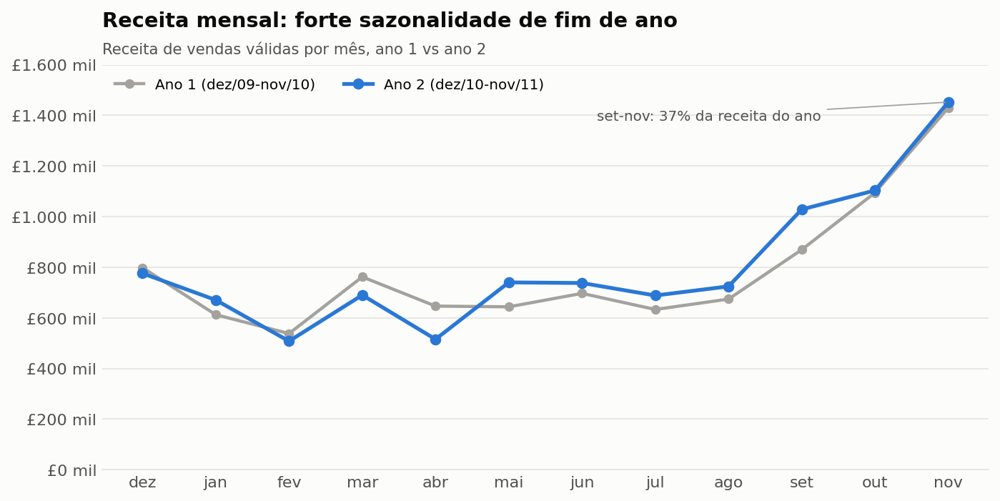
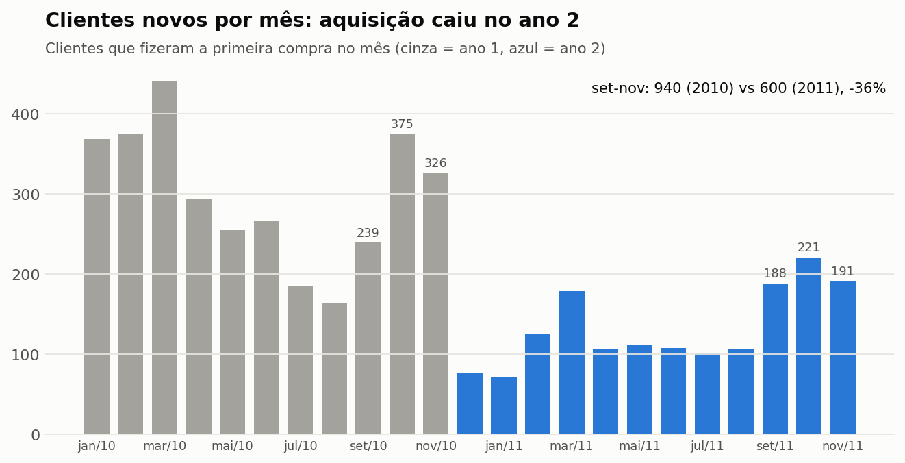
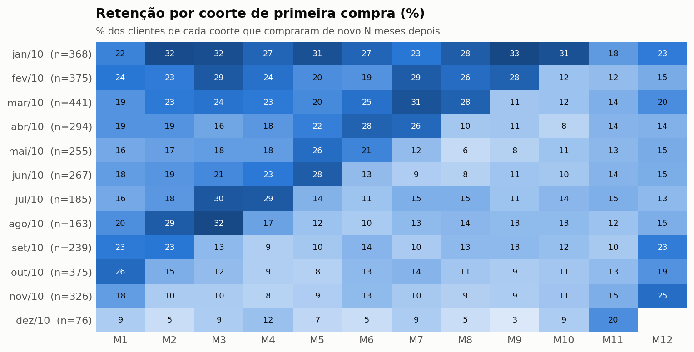
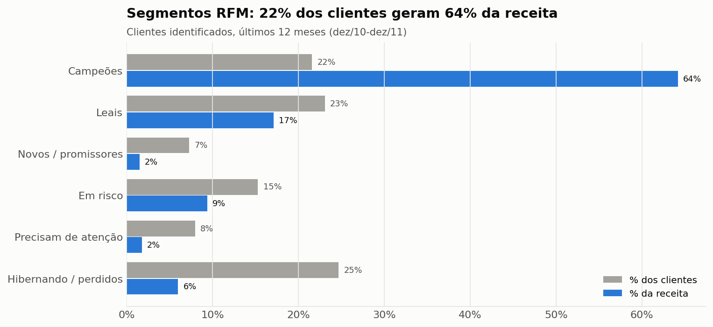
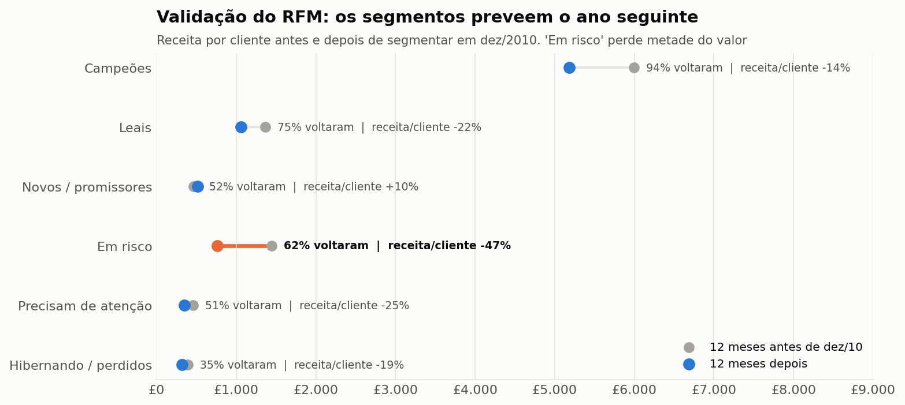
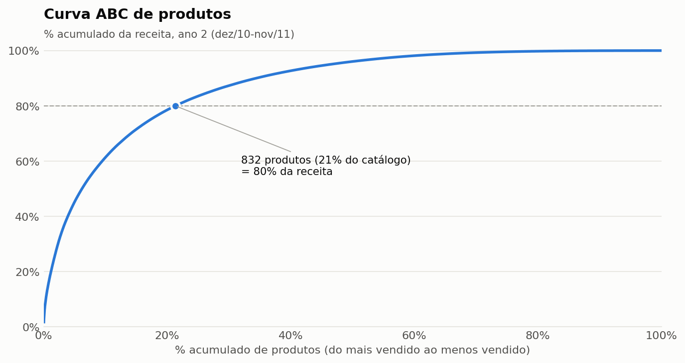
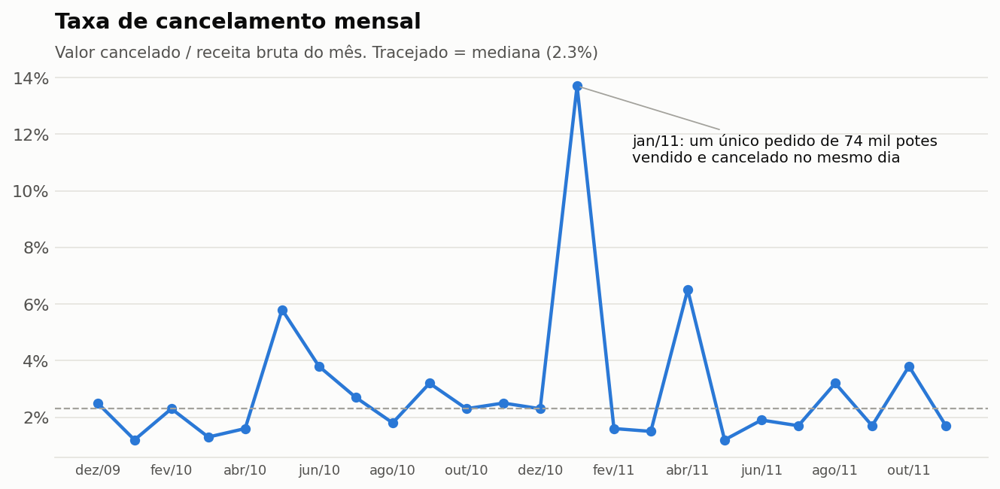
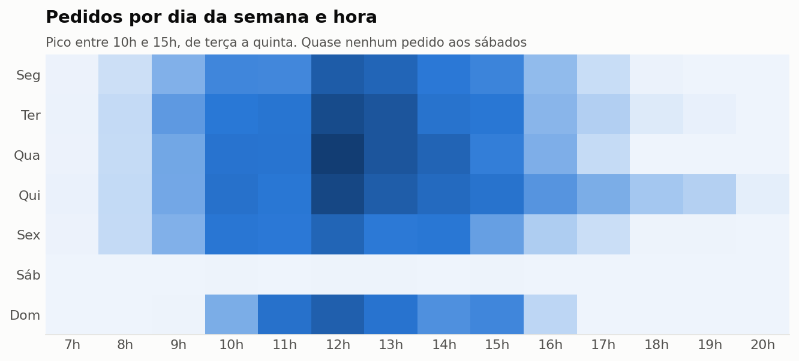
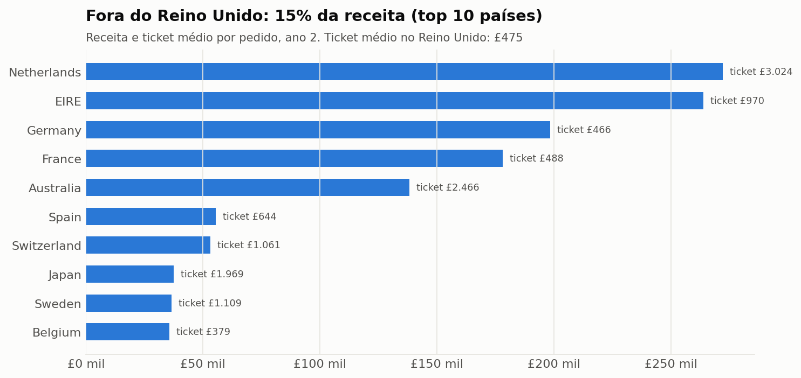

# Varejo online: análise de vendas e clientes em SQL

[](https://github.com/santana7o/varejo-online-sql/actions/workflows/pipeline.yml)

Projeto **SQL-first**: toda a limpeza, modelagem e cálculo de métricas é feita em SQL (DuckDB), sobre mais de 1 milhão de linhas de vendas reais de um e-commerce do Reino Unido. Python só orquestra a execução e gera os gráficos. Excel e um dashboard web são a camada de apresentação para quem não usa SQL.

**[Abrir o dashboard interativo](https://santana7o.github.io/varejo-online-sql/)** · [Relatório em Excel](relatorio/relatorio_varejo_online.xlsx) · [Consultas SQL](sql/)



## Em 30 segundos

- **Pergunta:** o negócio está crescendo de forma saudável? De onde vem a receita e onde estão os riscos?
- **Resposta:** a receita cresceu 2,5%, mas só porque o ticket médio subiu. A entrada de clientes novos caiu 36% e 64% da receita depende de 919 clientes.
- **Diferencial:** a segmentação de clientes foi **validada com dados do ano seguinte** (backtest), e a recomendação principal vem **dimensionada em libras**, com a lista de clientes priorizada para o time comercial.
- **Confiabilidade:** 10 testes de dados e um pipeline no GitHub Actions refazem tudo do zero a cada mudança e conferem se os resultados publicados batem com o SQL.

## Visão geral

| | |
|---|---|
| **Empresa** | E-commerce do Reino Unido que vende presentes e itens de decoração, com muitos clientes atacadistas |
| **Período** | dez/2009 a dez/2011 (1.067.371 linhas, 53.628 notas fiscais, 43 países) |
| **Entregáveis** | 14 consultas SQL de análise, 10 testes de dados, 9 gráficos, dashboard web e relatório em Excel |

## Principais conclusões

1. **A receita cresceu pouco e só por causa do ticket.** O ano 2 faturou 2,5% a mais (1,9% líquido de cancelamentos) com 4% menos pedidos. O ticket médio subiu 6,8%.
2. **A aquisição de clientes caiu.** Em set-nov, a empresa ganhou 600 clientes novos em 2011 contra 940 em 2010 (-36%). Cerca de 90% da receita mensal do ano 2 vem de quem já era cliente.
3. **A receita depende de poucos clientes.** Na segmentação RFM, 22% dos clientes (Campeões) geram 64% da receita. Outros 652 clientes, que compravam com frequência mas sumiram, estão "Em risco" e somam £795 mil.
4. **A segmentação prevê o futuro.** Aplicando a mesma regra em dez/2010, 94% dos Campeões voltaram a comprar no ano seguinte e geraram 68% da receita. Os clientes "Em risco" voltaram em 62% dos casos, mas gastaram 47% menos.
5. **Reativar o segmento "Em risco" vale £42 mil a £80 mil por ano a cada 10 pontos percentuais** de reativação acima da taxa natural. Os 103 clientes de maior valor concentram metade da receita do segmento.
6. **Sazonalidade forte.** Setembro a novembro concentram 37% da receita do ano. Quem compra pela primeira vez nesses meses some durante o ano e volta no Natal seguinte.
7. **Catálogo concentrado.** 832 de 3.904 produtos (21%) respondem por 80% da receita.
8. **Cancelamento sob controle, com exceções pontuais.** A taxa mediana é 2,3% ao mês. O pico de jan/2011 (13,7%) é um único pedido de 74.215 potes vendido e cancelado no mesmo dia.

**Recomendações**

- **Campanha de reativação do segmento "Em risco" antes do pico de fim de ano**, começando pelos 103 clientes de maior valor da [lista priorizada](resultados/14_lista_reativacao.csv). Cada 10 p.p. de reativação adicional vale £42 mil a £80 mil.
- **Tratar os Campeões como carteira:** atendimento dedicado e alerta quando um deles passar de 30 dias sem comprar. Eles geram dois terços da receita do ano seguinte.
- **Investigar a queda de aquisição** (canais, preço, concorrência). O crescimento atual depende de uma base que naturalmente perde clientes.
- **Planejar o ano a partir de agosto:** estoque dos produtos classe A, equipe e campanhas prontos antes de setembro. Clientes que entram no fim do ano devem receber comunicação forte a partir de setembro do ano seguinte, quando voltam a comprar.
- **Validar pedidos fora do padrão** (quantidade muito acima do histórico do cliente) antes do faturamento.

## Dashboard

O **[dashboard web interativo](https://santana7o.github.io/varejo-online-sql/)** (GitHub Pages) reúne KPIs, sazonalidade, novos vs recorrentes, RFM com validação, coortes, cancelamentos, países e um **simulador da campanha de reativação**. Ele é gerado a partir dos mesmos CSVs do SQL, em [docs/](docs/).

## Como garanto que os números estão certos

- **Testes de dados** ([sql/testes/testes_dados.sql](sql/testes/testes_dados.sql)): sem duplicatas no staging, linhas reconciliadas entre as tabelas, receita idêntica entre pedidos e itens, uma linha por nota fiscal, todo cliente em exatamente um segmento RFM, entre outros. Se um teste falha, a execução para.
- **Pipeline no GitHub Actions** ([.github/workflows/pipeline.yml](.github/workflows/pipeline.yml)): a cada push, baixa a base, roda tudo do zero e falha se os CSVs publicados forem diferentes dos gerados pelo SQL.
- **Regra de negócio escrita uma vez só:** a segmentação RFM é uma macro SQL (`rfm_clientes`) usada pela análise atual, pelo backtest, pelo dimensionamento e pela lista de reativação.
- **Versões fixas** em [requirements.txt](requirements.txt) e desempate explícito em todas as ordenações, para o resultado ser sempre o mesmo.

## Stack

- **DuckDB**: banco analítico local, sem servidor. A sintaxe segue a do PostgreSQL, com extensões próprias usadas aqui, como `SELECT * EXCLUDE` e macros de tabela.
- **SQL**: CTEs, window functions (`ROW_NUMBER`, `LAG`, `NTILE`, `FIRST_VALUE`, `RANK`, somas acumuladas, médias móveis), table macros, `FILTER`, `ARG_MAX`, `DATE_TRUNC`, `DATE_DIFF`.
- **Python**: pandas para exportar resultados e matplotlib para os gráficos.
- **Apresentação**: Excel (openpyxl) e dashboard web (HTML e Chart.js).
- **Qualidade**: testes de dados em SQL e CI com GitHub Actions.

## Modelagem dos dados

```
raw_vendas  (base bruta, 1.067.371 linhas)
   |
   |  remove duplicatas exatas, preços zerados e códigos que não são produto
   v
stg_vendas  (1.021.254 linhas)
   |
   +--> fato_vendas         vendas válidas, linha a linha (1.003.340)
   +--> fato_cancelamentos  notas iniciadas em "C", valores em positivo (17.914)
   +--> fato_pedidos        uma linha por nota fiscal (39.516 pedidos)
           |
           +--> rfm_clientes(data)   macro: segmentação RFM em qualquer data de referência
```

### Qualidade dos dados

| Problema encontrado | Linhas | % da base | Tratamento |
|---|---:|---:|---|
| Linhas duplicadas idênticas | 34.335 | 3,2% | Removidas com `ROW_NUMBER()` |
| Códigos que não são produto (frete, taxas, testes, vales) | 5.930 | 0,6% | Removidos |
| Preço zerado ou negativo | 6.207 | 0,6% | Removidos |
| Cancelamentos | 19.494 | 1,8% | Separados em `fato_cancelamentos` |
| Sem cliente identificado | 243.007 | 22,8% | Mantidos na receita, fora das análises de cliente |

Cada linha conta os casos sobre a base bruta, então as categorias se sobrepõem: uma linha duplicada também pode ter preço zerado. Por isso a soma das remoções não é exatamente a diferença entre `raw_vendas` e `stg_vendas`.

## Perguntas respondidas

| # | Pergunta de negócio | Técnica SQL | Arquivo |
|---|---|---|---|
| 01 | Quanto da base bruta é confiável? | `ROW_NUMBER`, `FILTER`, `FIRST_VALUE` | [01_qualidade_dados.sql](sql/01_qualidade_dados.sql) |
| 02 | O negócio cresceu? Por volume ou por ticket? | CTEs, `LAG` para variação anual | [02_kpis_anuais.sql](sql/02_kpis_anuais.sql) |
| 03 | Qual é a sazonalidade? O mês está acima do ano anterior? | Média móvel, `LAG(12)`, % do total por partição | [03_receita_mensal.sql](sql/03_receita_mensal.sql) |
| 04 | O crescimento vem de clientes novos ou recorrentes? | Primeira compra por cliente, `FILTER` | [04_novos_vs_recorrentes.sql](sql/04_novos_vs_recorrentes.sql) |
| 05 | Quantos clientes voltam a comprar com o passar dos meses? | Coortes com `DATE_DIFF` e `FIRST_VALUE` | [05_coortes_retencao.sql](sql/05_coortes_retencao.sql) |
| 06 | Quem são os clientes mais valiosos e quem está sumindo? | RFM com `NTILE(5)` em table macro | [06_rfm_segmentacao.sql](sql/06_rfm_segmentacao.sql) |
| 07 | Quantos produtos fazem 80% da receita? | Soma acumulada, curva ABC | [07_pareto_produtos.sql](sql/07_pareto_produtos.sql) |
| 08 | Quanto se perde em cancelamentos por mês? | `LEFT JOIN` entre agregações | [08_cancelamentos.sql](sql/08_cancelamentos.sql) |
| 09 | Algum produto cancela muito acima da média? | Taxa por produto | [09_cancelamentos_produtos.sql](sql/09_cancelamentos_produtos.sql) |
| 10 | Como os países fora do Reino Unido se comparam? | `RANK`, subconsulta escalar | [10_paises.sql](sql/10_paises.sql) |
| 11 | Em que dia e horário os clientes compram? | `ISODOW`, `HOUR` | [11_dia_hora.sql](sql/11_dia_hora.sql) |
| 12 | A segmentação RFM prevê o comportamento futuro? | Backtest: macro em data passada, `LEFT JOIN` com o ano seguinte, `MEDIAN` | [12_validacao_rfm.sql](sql/12_validacao_rfm.sql) |
| 13 | Quanto vale reativar os clientes "Em risco"? | Cenários com `VALUES`, `CROSS JOIN` | [13_dimensionamento_reativacao.sql](sql/13_dimensionamento_reativacao.sql) |
| 14 | Por quais clientes a campanha deve começar? | `ARG_MAX`, `ROW_NUMBER`, % acumulado | [14_lista_reativacao.sql](sql/14_lista_reativacao.sql) |

### Exemplo: a segmentação RFM como macro, validada no passado

A regra fica em um só lugar ([sql/00_modelagem.sql](sql/00_modelagem.sql)) e recebe a data de referência:

```sql
CREATE OR REPLACE MACRO rfm_clientes(data_ref) AS TABLE
WITH base_cliente AS (
    SELECT cliente_id,
           DATE_DIFF('day', MAX(data), data_ref) AS recencia_dias,
           COUNT(*)                              AS frequencia,
           SUM(valor)                            AS valor
    FROM fato_pedidos
    WHERE cliente_id IS NOT NULL
      AND data >= data_ref - INTERVAL 365 DAY AND data < data_ref
    GROUP BY cliente_id
),
notas AS (
    SELECT *,
        NTILE(5) OVER (ORDER BY recencia_dias DESC, cliente_id) AS r,   -- 5 = comprou ha pouco tempo
        NTILE(5) OVER (ORDER BY frequencia ASC, cliente_id)     AS f,
        NTILE(5) OVER (ORDER BY valor ASC, cliente_id)          AS m
    FROM base_cliente
)
SELECT *,
    CASE
        WHEN r >= 4 AND f >= 4 AND m >= 4 THEN '1. Campeões'
        WHEN r >= 3 AND f >= 3            THEN '2. Leais'
        WHEN r >= 4 AND f <= 2            THEN '3. Novos / promissores'
        WHEN r <= 2 AND f >= 3            THEN '4. Em risco'
        WHEN r = 3                        THEN '5. Precisam de atenção'
        ELSE                                   '6. Hibernando / perdidos'
    END AS segmento
FROM notas;
```

O mesmo código segmenta o presente (`rfm_clientes((SELECT MAX(data) + 1 FROM fato_pedidos))`) e o passado (`rfm_clientes(DATE '2010-12-10')`), o que permite medir se os segmentos acertaram. Em empates de recência, frequência ou valor, o desempate do `NTILE` é feito pelo `cliente_id`, para o resultado ser sempre o mesmo.

## Resultados

### Clientes novos por mês



### Retenção por coorte



Leitura: dos 368 clientes que compraram pela primeira vez em jan/2010, 22% voltaram no mês seguinte e 23% ainda compravam 12 meses depois. As coortes de set a nov/2010 caem para cerca de 10% ao mês, mas voltam a 19% a 25% em M12, um ano depois da primeira compra: esses clientes não abandonaram a loja, eles compram para o Natal e voltam na temporada seguinte.

### Segmentos RFM



| Segmento | Clientes | % clientes | % receita | Recência média (dias) |
|---|---:|---:|---:|---:|
| Campeões | 919 | 21,6% | 64,2% | 13 |
| Leais | 985 | 23,1% | 17,1% | 33 |
| Novos / promissores | 312 | 7,3% | 1,5% | 18 |
| Em risco | 652 | 15,3% | 9,4% | 143 |
| Precisam de atenção | 340 | 8,0% | 1,8% | 52 |
| Hibernando / perdidos | 1.053 | 24,7% | 6,0% | 206 |

### Validação do RFM (backtest)



A mesma regra foi aplicada em 10/12/2010, usando só os 12 meses anteriores, e comparada com o que cada cliente fez nos 12 meses seguintes:

| Segmento em dez/2010 | Clientes | Voltaram a comprar | Receita por cliente (antes → depois) | % da receita do ano seguinte |
|---|---:|---:|---:|---:|
| Campeões | 881 | 94% | £5.994 → £5.185 | 67,9% |
| Leais | 976 | 75% | £1.364 → £1.056 | 15,3% |
| Novos / promissores | 345 | 52% | £467 → £512 | 2,6% |
| Em risco | 676 | 62% | £1.443 → £760 | 7,6% |
| Precisam de atenção | 331 | 51% | £459 → £345 | 1,7% |
| Hibernando / perdidos | 1.014 | 35% | £395 → £321 | 4,8% |

A ordem dos segmentos se mantém no ano seguinte, então a segmentação serve para decidir onde investir. O segmento "Em risco" é o que mais perde valor: a maioria volta, mas comprando metade.

### Dimensionamento da reativação

| Cenário | Reativação adicional | Clientes a mais | Receita adicional em 12 meses |
|---|---:|---:|---:|
| Baixo | +5 p.p. | 33 | £21 mil a £40 mil |
| Médio | +10 p.p. | 65 | £42 mil a £80 mil |
| Alto | +20 p.p. | 130 | £84 mil a £159 mil |

A faixa usa a mediana (£646) e a média (£1.227) do que os clientes "Em risco" que voltaram gastaram no ano seguinte. O custo da campanha não está incluído: o número serve como teto de investimento para o canal de reativação.

### Curva ABC de produtos



### Cancelamentos



### Quando os clientes compram



### Países



Holanda e Austrália têm ticket médio 6,4 e 5,2 vezes o do Reino Unido, com poucos clientes: perfil de atacado e conta-chave.

## Como executar

Funciona em Windows, Mac e Linux. Precisa de Python 3.11 ou mais novo.

```bash
git clone https://github.com/santana7o/varejo-online-sql.git
cd varejo-online-sql
python -m venv .venv
source .venv/bin/activate        # no Windows: .venv\Scripts\activate
pip install -r requirements.txt
python executar_projeto.py
```

O script baixa a base da UCI (cerca de 45 MB), cria `data/varejo.duckdb`, roda as consultas e os testes, e gera `resultados/`, `assets/`, `relatorio/` e `docs/dados.js`. A execução completa leva menos de 1 minuto.

No Mac com Python instalado pelo python.org, se o download falhar com erro de certificado SSL, rode uma vez o `Install Certificates.command` da pasta `/Applications/Python 3.x/`.

Para explorar os dados com outra ferramenta, abra `data/varejo.duckdb` no DBeaver ou rode as consultas da pasta `sql/` no terminal do DuckDB.

## Estrutura

```
varejo-online-sql/
├── sql/              00 modelagem + 14 consultas de análise
│   └── testes/       testes de dados
├── scripts/          01 dados, 02 consultas, 03 testes, 04 gráficos, 05 Excel, 06 dashboard
├── resultados/       saída de cada consulta em CSV
├── assets/           gráficos do README
├── relatorio/        relatorio_varejo_online.xlsx
├── docs/             dashboard web (GitHub Pages)
├── .github/          pipeline de CI
└── data/             banco local (gerado pelo script, fora do Git)
```

## Limitações

- 22,8% das linhas não têm cliente identificado. A receita total as inclui, mas as análises de cliente (coortes, RFM, novos vs recorrentes) não.
- A base começa em dez/2009. Clientes que já compravam antes aparecem como "novos" no início de 2010, o que infla a aquisição desse período. Por isso a comparação de clientes novos usa set-nov, meses já distantes do início da base.
- O backtest do RFM tem um único ponto no tempo (dez/2010), porque a base cobre só dois anos. Com mais histórico, o ideal seria repetir a validação em várias datas.
- O dimensionamento assume que o cliente reativado pela campanha gasta como o cliente que voltou sozinho. O custo da campanha e o efeito real só podem ser medidos com um teste A/B (grupo de controle sem contato).
- O pedido de 74 mil potes (jan/2011) entra na receita bruta e no cancelamento. Na receita líquida ele se anula.
- Dezembro de 2011 tem apenas 9 dias e fica fora das comparações mensais e anuais.

## Fonte dos dados

Chen, D. (2012). *Online Retail II* [Dataset]. UCI Machine Learning Repository. https://doi.org/10.24432/C5CG6D. Licença CC BY 4.0.

## Autor

**Felipe Santana**, analista de dados
GitHub: [santana7o](https://github.com/santana7o)
